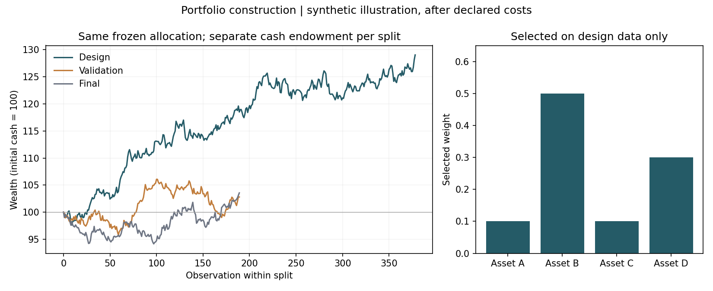

# Portfolio construction with explicit constraints

A small, reproducible Python demonstration of how to screen allocations, select one portfolio on a chronological design period, and report later outcomes without changing the selection.

**Every input is synthetic.** Asset A–D are abstract labels. The data, returns, costs and results do not represent securities, clients, investment recommendations or a validated market strategy. The single seed and all rules are fixed in `Config`; no seed search was performed.



## What the experiment does

1. Generate 756 weekday observations of correlated simple returns for four abstract assets using NumPy `default_rng`, seed `20261105`. The weekday calendar is artificial and does not model exchange holidays.
2. Split them chronologically into **378 design, 189 validation and 189 final** observations. There is no overlap. Each split receives fresh cash of 100; the three curves are separate evaluation paths, not one tradable compounded history.
3. Enumerate all fully invested allocations on a 10% grid: **286** integer compositions. Retain **75** allocations satisfying long-only weights of 10–60% per asset and a combined A+B weight of at most 70%. Rejection reasons remain visible.
4. Evaluate feasible candidates on design data only. Select the highest net-of-declared-costs design Sharpe with a lexical candidate-ID tie-break. Stop on undefined scores or infeasibility. **Select once: no fallback, replacement, tuning or second search uses validation/final results.**
5. Apply the frozen allocation separately to validation and final data, retaining the outcome even if it is poor. These artificial splits illustrate software separation; they provide no empirical confirmation of investment effectiveness.

## Accounting and risk definitions

The portfolio buys its initial holdings, then holds asset units between annual rebalances. Rebalances occur before the first supplied observation of each new calendar year.

The declared scenario charges **5 basis points on actual gross buy-plus-sell notional**, including the initial purchase. There is no charge on unchanged holdings. Initial invested value is `cash / (1 + rate)`. A rebalance solves

```text
fee = rate * sum(abs((pre_fee_value - fee) * target_weights - old_holdings))
```

with 64 bisection steps; post-fee holdings sum to pre-fee capital minus the fee. This is a proportional-cost illustration, with no minimum fee, spread, market impact, tax, funding or empirical fee calibration. There is no borrowing, shorting or cash interest.

Daily net returns come from successive wealth ratios and include entry/rebalance fees. Reported metrics are total return, 252-observation CAGR, annualized arithmetic mean and sample volatility, zero-risk-free Sharpe, maximum drawdown, daily VaR95 and daily Expected Shortfall95. Drawdown includes **initial cash as the first peak**, so a loss on the first day is counted. VaR uses the linear empirical loss quantile. ES averages exactly the worst 5% of empirical loss mass, using fractional weight at the boundary. Loss is `-net_return`, so a risk measure can be negative when even the tail is profitable.

The finite-grid optimum is conditional on this objective, sample and constraints. It is not a continuous global optimum. No confidence interval or multiple-testing correction is claimed.

## Setup and run

The recorded reference environment is **Python 3.9.1**, NumPy **2.0.2**, matplotlib **3.9.4**, on Windows. Only the two direct runtime dependencies appear in `requirements.txt`; their transitive dependencies are resolved by pip. This is not a complete transitive lockfile.

From the repository root, a Windows PowerShell setup is:

```powershell
python -m venv .venv
.\.venv\Scripts\python.exe -m pip install -r requirements.txt
.\.venv\Scripts\python.exe tools\validate.py
```

The install command requires normal package-index access. **Tests and the demo itself run offline:** they perform no downloads, use no credentials and call no paid API. Using the same configured Python environment, the individual commands are:

```text
python -m unittest discover -s tests -v
python src/portfolio_demo.py --output outputs
python tools/validate.py
```

`tools/validate.py` runs the first two commands, records actual exit codes and wall times, and updates `VALIDATION.md`, `outputs/validation_run.json` and `outputs/summary.json`. Run it last to attach a validation record to the generated outputs. Running the demo alone deliberately marks that invocation's validation as unrecorded. Timings include import/startup and are not performance benchmarks. A previous development record does not itself prove a fresh installation.

## Expected artifacts and checks

| File | Contents |
|---|---|
| `outputs/synthetic_returns.csv` | 756 synthetic date/return rows for four assets |
| `outputs/candidate_screening.csv` | 286 allocations, feasibility, rejection reasons and design-only scores |
| `outputs/selected_portfolio_daily.csv` | Net wealth, returns, paid fees and gross traded notional; an explicit INITIAL row per split |
| `outputs/metrics.csv` | Three rows of return/risk metrics for the frozen allocation |
| `outputs/portfolio_overview.png` | Separate split wealth paths and selected weights |
| `outputs/summary.json` | Assumptions, split dates, selected weights, metrics, source/output hashes and validation status |
| `outputs/validation_run.json` | Actual subprocess commands, results, elapsed times and diagnostic logs |

The reference choice is **`W_1_5_1_3`**, with A/B/C/D weights **0.10 / 0.50 / 0.10 / 0.30**. Reference checks for the same fixed synthetic input are:

| Split | Observations | Maximum drawdown | Daily ES95 loss |
|---|---:|---:|---:|
| Design | 378 | -0.042565762058712 | 0.011833495505635 |
| Validation | 189 | -0.066602110001735 | 0.009667839754820 |
| Final | 189 | -0.058622801720353 | 0.011200537828763 |

These are **synthetic numerical reference values**, not performance evidence. Compare scalar metrics with absolute tolerance `1e-10` across compatible environments. Counts, IDs and constraints should match exactly. PNG byte hashes can vary with plotting dependencies and platforms. Source hashes identify the local files that produced an output, rather than proving the entire software supply chain.

The 11 focused tests include hand-calculated first-day drawdown, fractional ES, annual rebalancing and actual-cost accounting; infeasible constraints; duplicate dates and invalid returns; exact same-environment seed reproduction; a future-tampering test that forces later losses without changing any design score or selected allocation; a check that selection is called once with design rows only; and a smoke export with matching artifact hashes. A deterministic artificial experiment is a software demonstration, not a statistical backtest on independent market episodes.

## Relationship to the original portfolio project

An earlier internship-related project recorded **65,807 candidate allocations** in its own saved output manifest. That is separate historical work. **This repository does not reproduce that project, its universe, allocation rules, data or results.** Its deliberately smaller 286/75-candidate experiment was written independently for this public demonstration. No original source file, price series, holdings, client profile, report, configuration, identifier list or proprietary baseline is included.

Algorithmic provenance is the standard mathematical definitions stated above: exhaustive enumeration of a finite weight grid, buy-and-hold compounding between scheduled rebalances, sample mean/volatility, wealth-based drawdown and empirical tail averaging. The implementation is newly written; no third-party code snippets, notebooks or trained models were copied. This is not a paper-replication claim. See [rights and provenance](RIGHTS_AND_PROVENANCE.md) and the [actual validation record](VALIDATION.md).

[Subba Cecchetto — professional portfolio](https://subbace.github.io/)


## Clean independent environment validation

A fresh local Git clone was verified byte-for-byte and the README commands were executed in a new isolated **CPython 3.12.14 / Windows / CPU** environment. Installation, checks and examples all exited **0**. The exact commands, versions, installed distributions and wall times are in [validation/CLEAN_ENVIRONMENT.json](validation/CLEAN_ENVIRONMENT.json). Other operating systems are not tested. Timing is engineering evidence, not an economic or algorithmic speed claim.

Recorded passing counts: unit_tests_passed = 11. These counts describe tests, not project completion or investment effectiveness.

The initial packaging check found Git line-ending conversion before any tests ran. Its clone was preserved and the source bytes were restored through a separate checkout with explicit `.gitattributes`; no source guard or test was removed.


## Clone this public demonstration

```text
git clone https://github.com/subbace/portfolio-construction-demo.git
cd portfolio-construction-demo
```

Then follow the setup and run commands above. See the [professional portfolio](https://subbace.github.io/#work) for the other documented workstreams. Public source is provided for independent inspection and running the accompanying example; no general open-source reuse licence is asserted.
